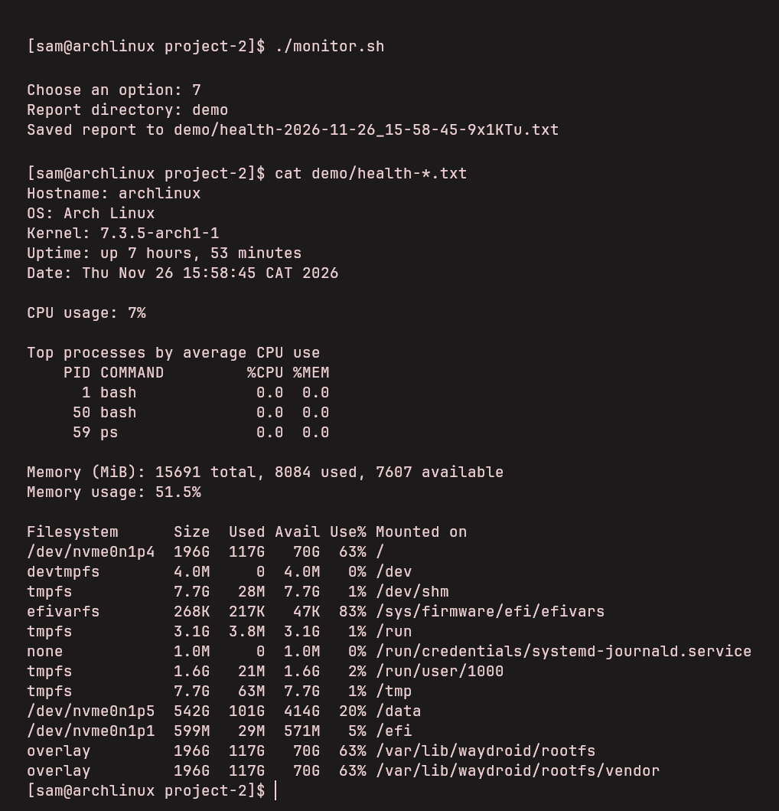
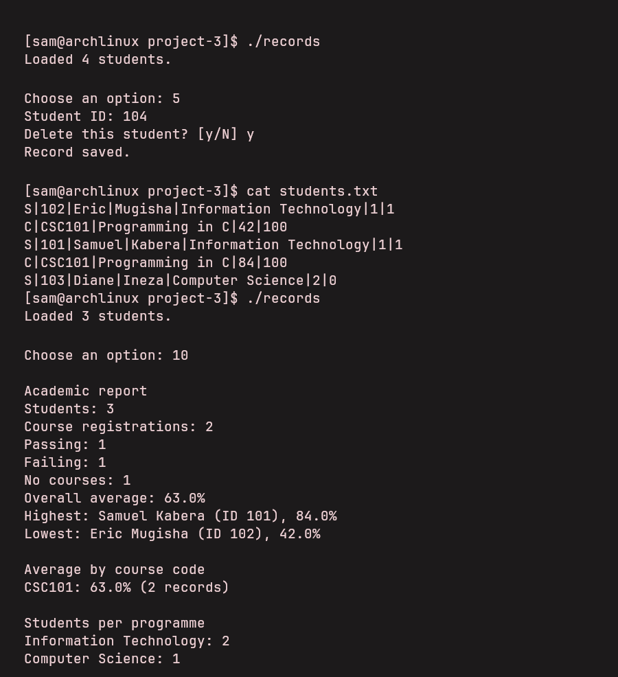
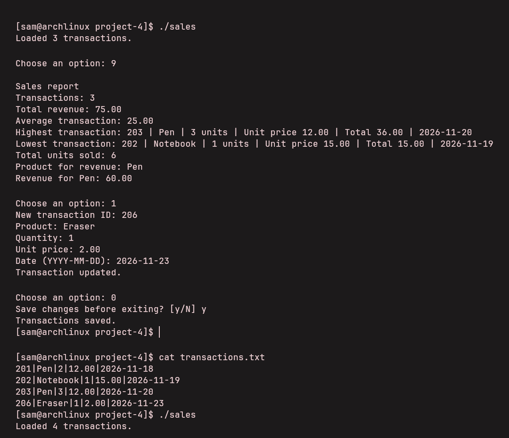
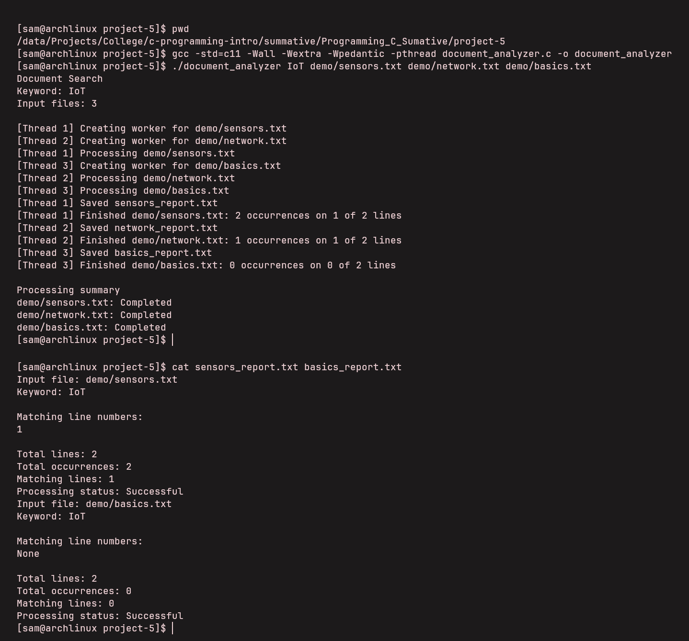

# C Programming Summative Technical Report

This report covers my five summative projects. I used an Arduino sketch for the room counter, a Bash script for system monitoring, and C for the student records, sales, and document search programs. Each project has its own folder with the source code and a README with demo instructions.

## Project 1 Smart Occupancy Monitoring and Access Control

[Project folder](project-1/) · [Source code](project-1/project-1.ino)

I built an Arduino Uno circuit to track how many people are in a room that holds up to five. One button counts an entry and the other counts an exit. The LCD shows the number inside and the spaces left. A green LED shows that space is available, and a red LED shows that the room is full.

I store the count and limit in a struct. The sketch waits for a stable button press before changing the count so a single press registers once.

[Hosted Tinkercad circuit](https://www.tinkercad.com/things/eUmNP0nMBtU/editel?returnTo=%2Fdashboard) · [Wiring and setup](project-1/README.md)

## Project 2 Linux System Health Monitor

[Project folder](project-2/) · [Source code](project-2/monitor.sh)

I wrote a Bash menu to check CPU, memory, and disk usage, search for running processes, and save a health report. The script measures CPU usage from two readings one second apart. It uses Linux commands for memory and disk usage.

The demo report showed 7% CPU usage, 51.5% memory usage, and 63% usage on the root filesystem. The script found a temporary sleep process and confirmed that it sent SIGTERM to it.

[Demo steps and screenshots](project-2/README.md#demonstration) · [Sample report](project-2/demo/health-report.txt)

## Project 3 Student Academic Records

[Project folder](project-3/) · [Source code](project-3/records.c)

I use this C program to register students, add courses, and update marks. It keeps students and courses in arrays that can grow as entries are added. It saves edits to a text file and loads the file when the program starts.

In the demo, I added a student, changed a course mark, searched and sorted the records, and deleted the temporary student. After restarting, the report showed one passing student, one failing student, and one student with no courses. The overall average was 63.0%.

[Demo steps and screenshots](project-3/README.md#demonstration) · [Sample report](project-3/demo/academic-report.txt)

## Project 4 Sales Transaction Analysis

[Project folder](project-4/) · [Source code](project-4/sales.c)

I wrote this C program to save sales, find transactions, and calculate revenue. I store prices in cents. The processing menu uses function pointers to select a calculation. Filtering and sorting use functions passed in as callbacks.

I filtered the sample sales for pens, sorted by total, then saved and reloaded the data. The report showed three transactions, total revenue of 75.00, an average of 25.00, and pen revenue of 60.00.

[Demo steps and screenshots](project-4/README.md#demonstration) · [Sample report](project-4/demo/sales-report.txt)

## Project 5 Multithreaded Document Search

[Project folder](project-5/) · [Source code](project-5/document_analyzer.c)

I wrote this C program to look for a keyword in several text files. Each file gets its own POSIX thread and report. The main thread waits for all workers before printing the final summary. The search ignores letter case and counts every match even when several are on the same line.

I searched for IoT in three sample files. The sensor file had two matches on one line, the network file had one lowercase match, and the C basics file had zero matches. The program wrote a separate report for each file.

[Demo steps and screenshots](project-5/README.md#demonstration) · [Sample report](project-5/demo/sensors_report.txt)

## Conclusion

The demos show how the programs handle their main tasks, from checking room capacity to saving records and writing search reports. The project READMEs have the steps, sample files, and output needed to repeat the demos.
