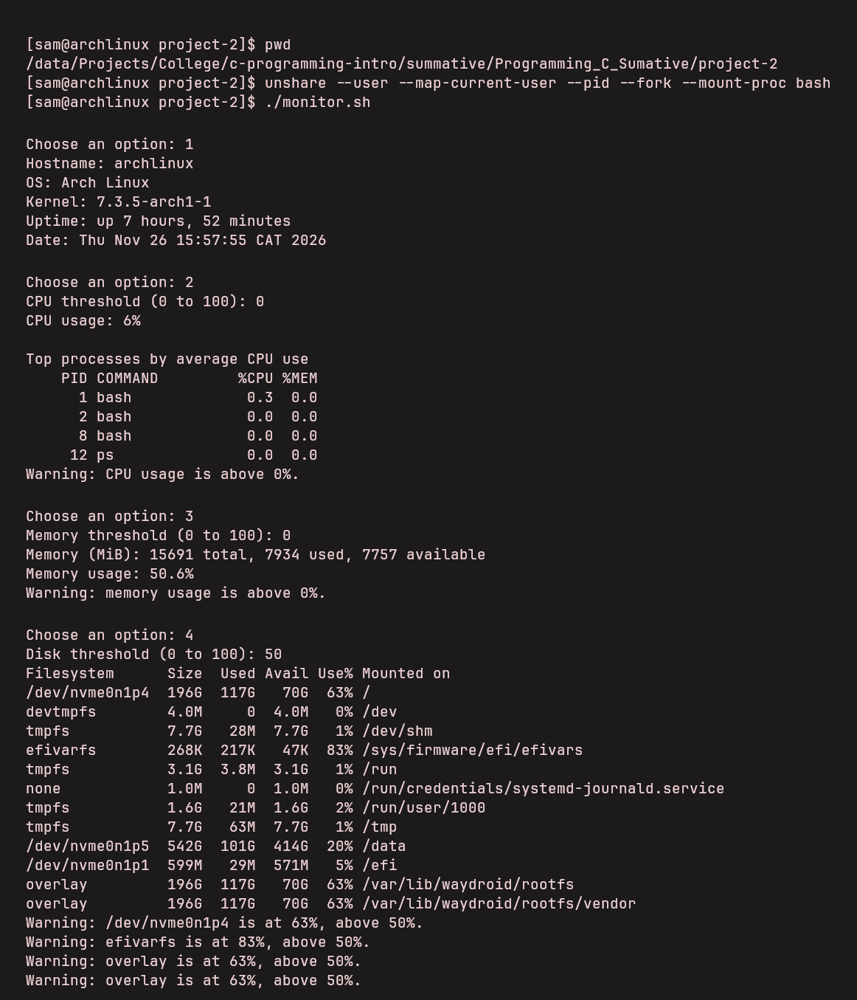
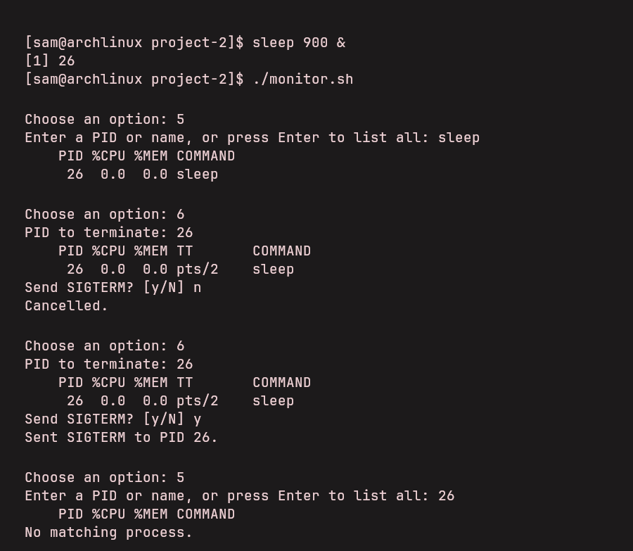
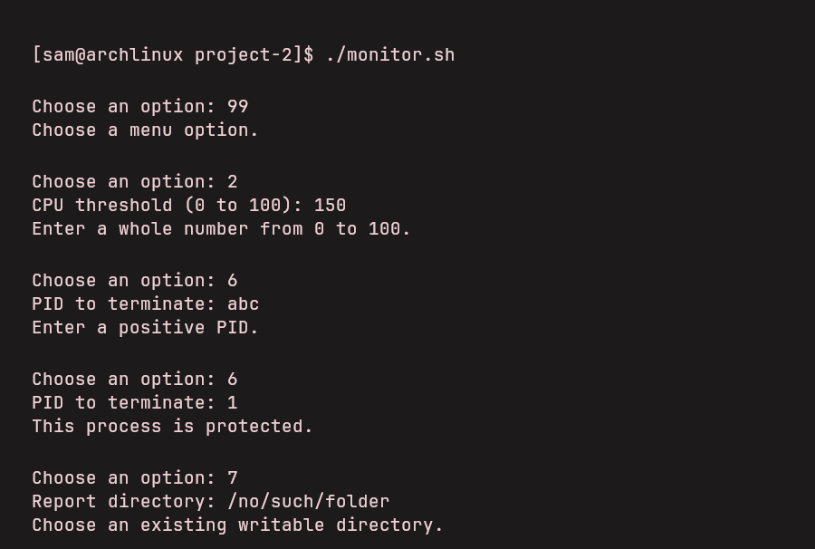
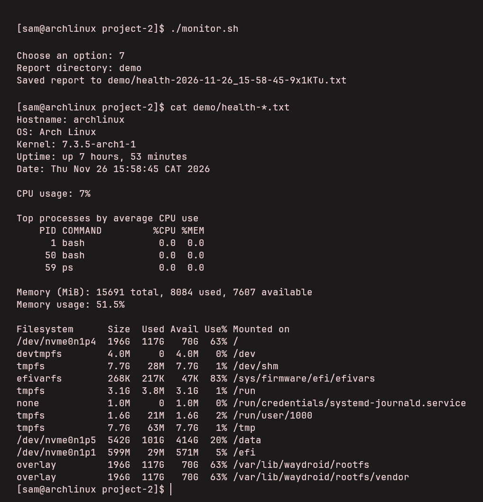
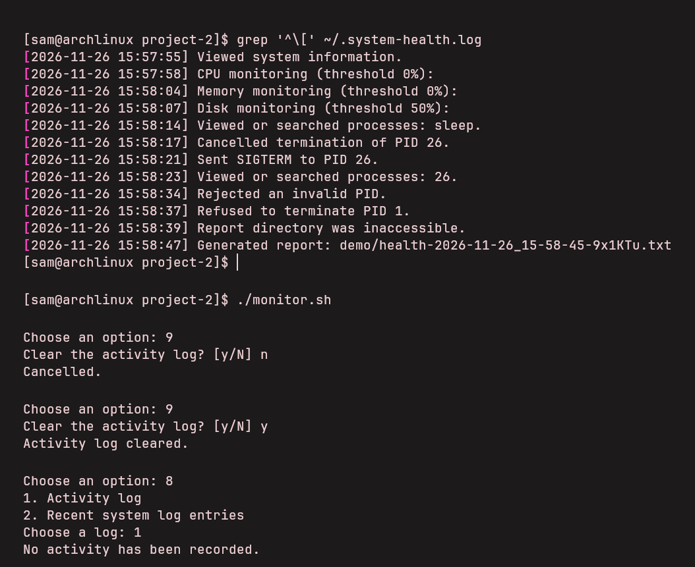

# Linux System Health and Resource Monitoring Manager

I use this Bash menu to check system resources, look up processes, and save a health report.

## Demonstration

I run the script in a separate process view with `unshare`. The process lists show only the processes from this demo. CPU, memory, and disk figures are for the whole computer.

From this folder, run:

```bash
unshare --user --map-current-user --pid --fork --mount-proc bash
sleep 900 &
./monitor.sh
```

Type `exit` after the demo to leave the separate process view.

### Resource monitoring

I view the system information with **1**. I use thresholds of `0`, `0`, and `50` with options **2**, **3**, and **4** to show warnings.



### Process management

I search for `sleep`, cancel one termination, confirm the next one, and check that the process has gone.



### Invalid input

The script rejects a bad menu option, threshold, PID, and folder. It also protects PID 1, which is the demo shell in this view.



### Health report

I choose **7**, enter `demo` as the folder, exit, and open the saved report. I then renamed it to `health-report.txt`.



### Activity log

I show the timestamped lines of the log. Clearing it needs confirmation.



### Supporting files

- [Generated health report](demo/health-report.txt)
- [Activity log excerpt](demo/activity-log.txt)

## Run it

Open a Linux terminal in this folder and run:

```bash
./monitor.sh
```

The script uses Bash, `/proc`, and standard Linux commands such as `ps`, `free`, and `df`. System journal viewing uses `journalctl` if it is installed and you have access.

## How it works

- I read `/proc/stat` twice, one second apart, to measure CPU use. The process list shows average CPU use from `ps`.
- I use `free` for memory and `df` for disk space. Each monitor asks for a threshold from 0 to 100.
- Process search takes an exact PID or part of a process name. The script checks ownership, the terminal, and protected PIDs before asking to send SIGTERM. It checks the process again after confirmation.
- Reports go into an existing writable folder that you choose. The activity log is saved to `~/.system-health.log` by default. Set `SYSTEM_HEALTH_LOG` to use a different file.
