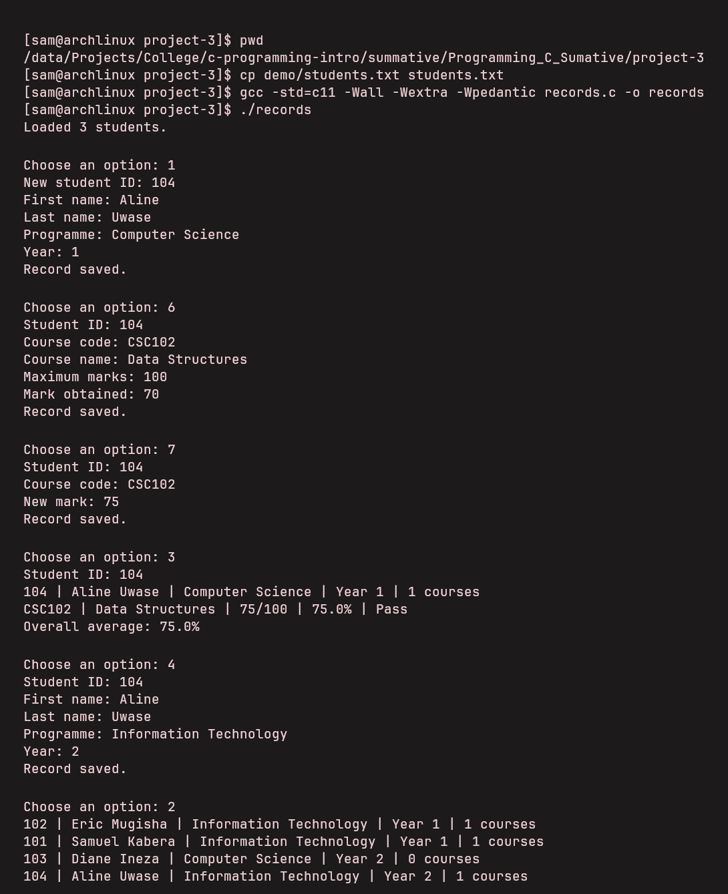
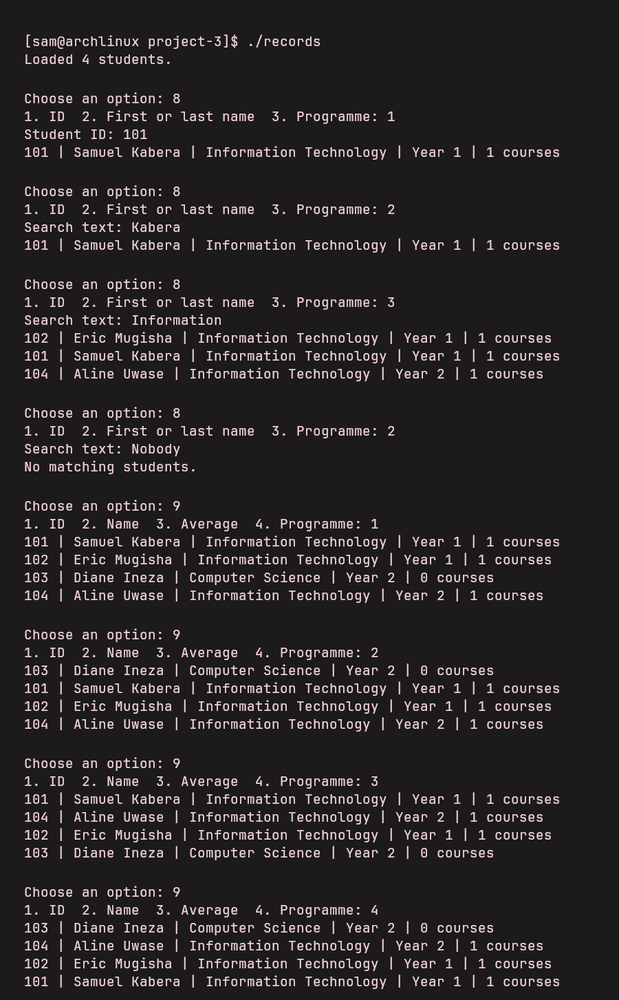
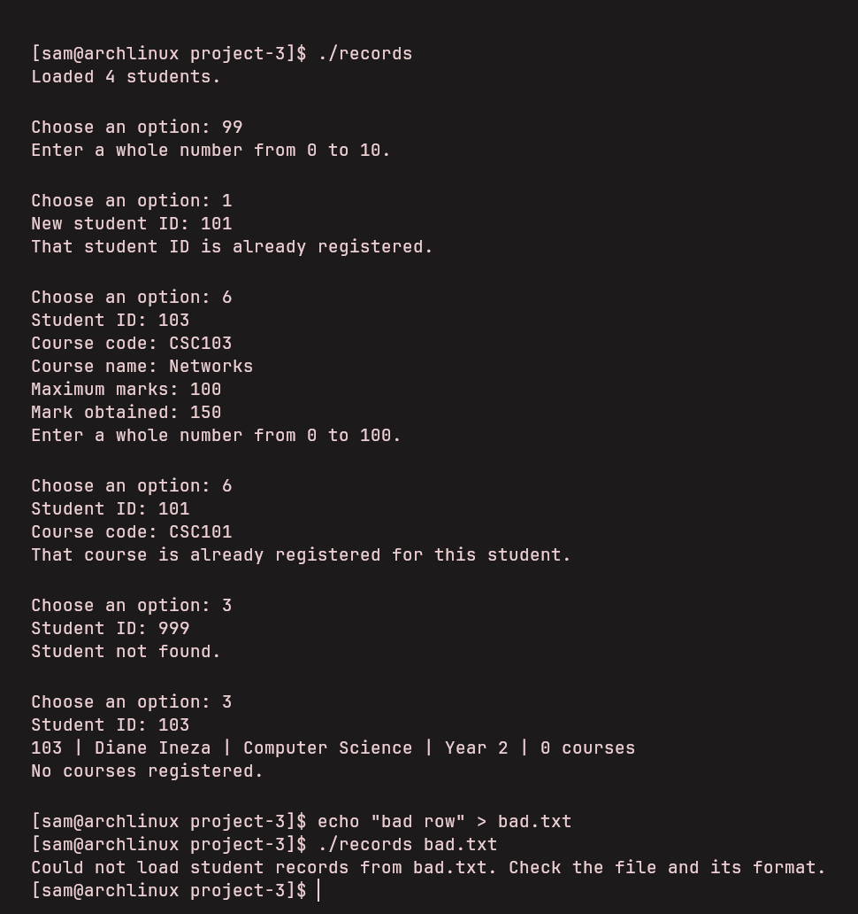
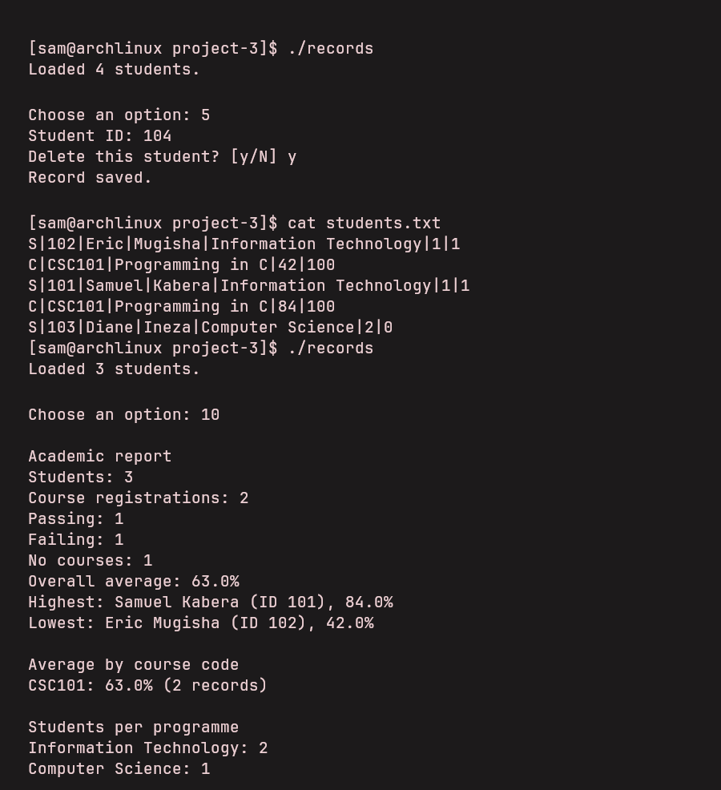

# Student Academic Records and Performance Analytics

I use this program to keep student details, register courses, and check academic results.

## Demonstration

I start with three fictional records and add a fourth to try the editing options. From this folder, run:

```bash
cp demo/students.txt students.txt
gcc -std=c11 -Wall -Wextra -Wpedantic records.c -o records
./records
```

### Add and update records

I register Aline Uwase, add a course, change the mark, and update the student details.



### Search and sort

I try every search type and sort order. Students with no courses go last when I sort by average.



### Validation

The program rejects bad options, duplicates, bad marks, and a damaged file.



### Saved records and academic report

I delete student `104`, check the saved file, restart, and choose **10**.



### Supporting files

- [Sample student records](demo/students.txt)
- [Academic report output](demo/academic-report.txt)

## Build and run

From this folder:

```bash
gcc -std=c11 -Wall -Wextra -Wpedantic records.c -o records
./records
```

The program loads `students.txt` at startup and saves after each edit.

## How it works

- I store students in a dynamic array. Each student has a separate array of courses. Pointers give the menu functions access to the student or course they need. The arrays grow with `realloc` and are freed when the program closes.
- I search by checking each student in order. I use selection sort to put the students in the requested order. Name and programme searches match part of the text and are case-sensitive.
- I divide total marks earned by total possible marks for each student. A student passes only if every course reaches 50%. The report counts students with no courses separately. Course averages use the percentage from each student's record for that course code.
- The file uses a student row followed by that student's course rows. I check IDs, marks, and the file format when loading. If a save fails, the previous file stays in place and the program reports the error.
