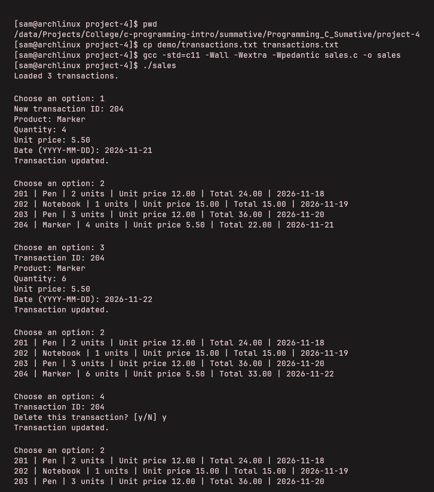
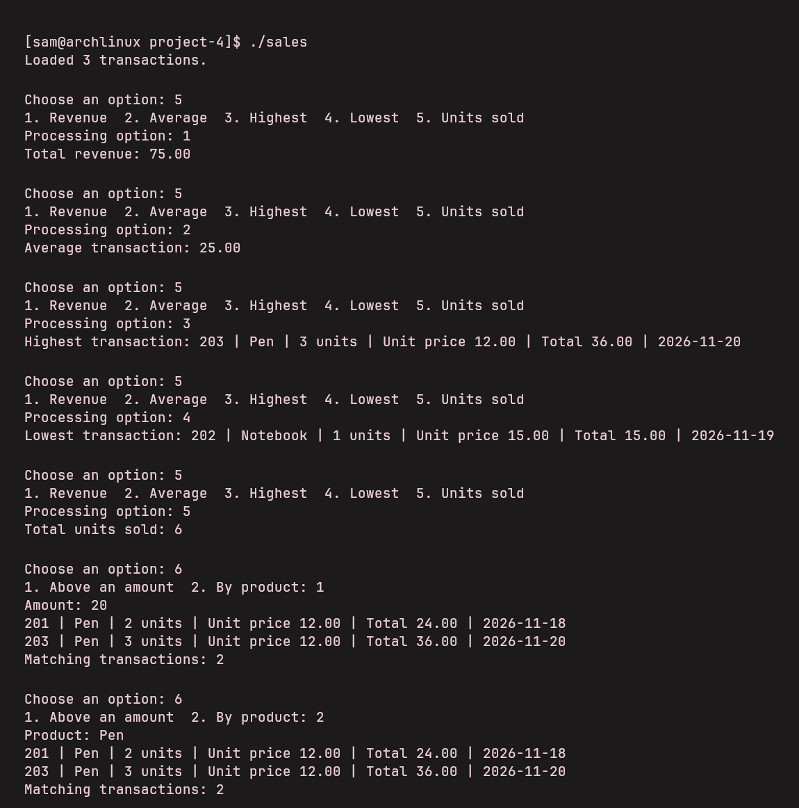
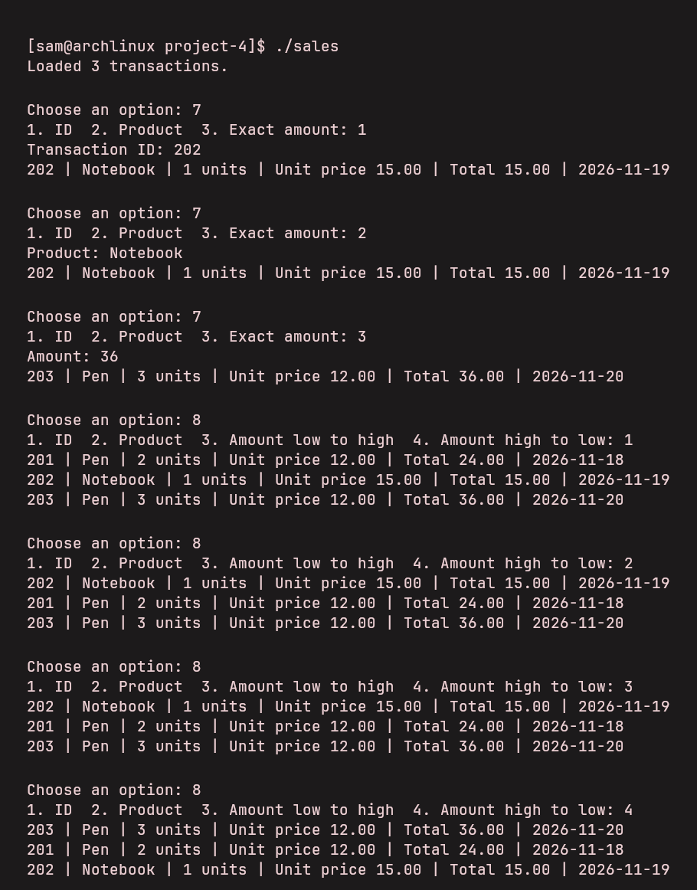
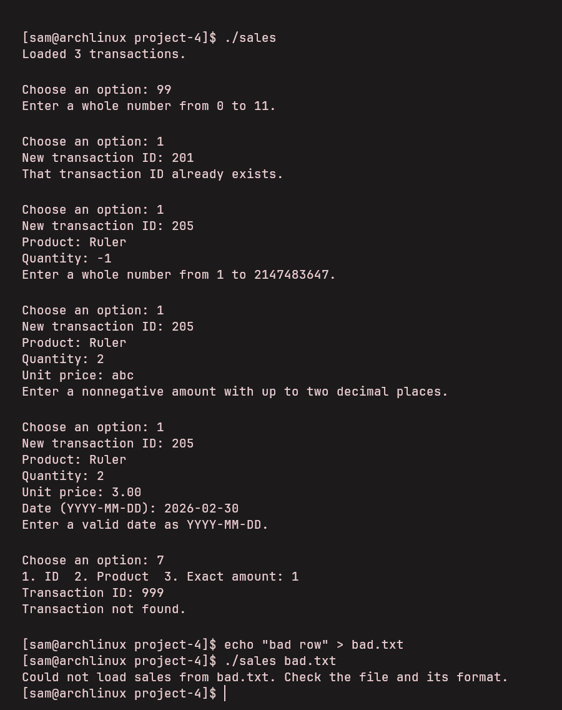
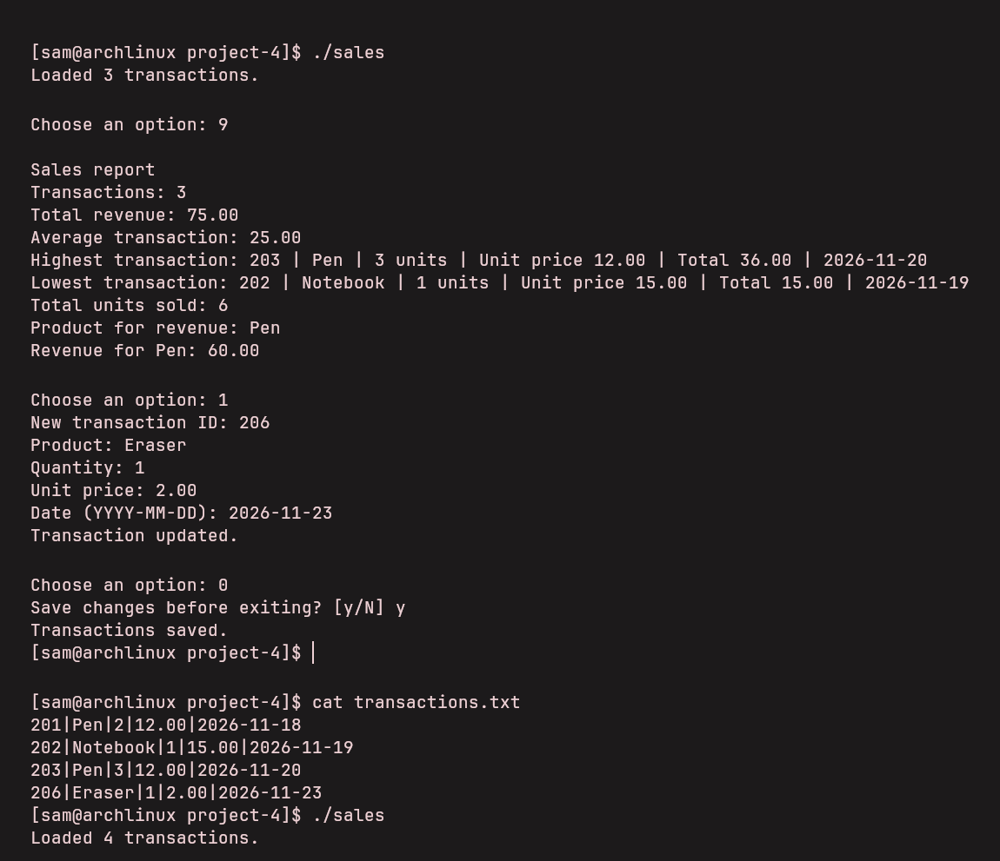

# Sales Transaction Processing and Analysis

I use this program to enter sales, find transactions, and see how much each product earned.

## Demonstration

I start with three sample sales. From this folder, run:

```bash
cp demo/transactions.txt transactions.txt
gcc -std=c11 -Wall -Wextra -Wpedantic sales.c -o sales
./sales
```

### Add, update, and delete

I add sale `204`, change it, and delete it. I list the sales after each step.



### Function pointers and callbacks

The five processing options use function pointers. The two filters use callbacks.



### Search and sort

I try all three searches and all four sort orders. Selection sort uses a comparison callback.



### Validation

The program rejects bad options, duplicate IDs, bad values, and a damaged file.



### Report, save, and reload

I show the report for pens, add a sale, save on exit, and load the file again.



### Supporting files

- [Sample transactions](demo/transactions.txt)
- [Sales report output](demo/sales-report.txt)

## Build and run

From this folder:

```bash
gcc -std=c11 -Wall -Wextra -Wpedantic sales.c -o sales
./sales
```

The program uses `transactions.txt` for saved data.

## How it works

- I keep transactions in a dynamic array. It grows with `realloc` when it fills up. Each transaction stores its price and total in cents.
- The processing menu uses an array of function pointers to call the selected calculation. The filter takes a callback that checks the amount or product. I use a comparison callback in selection sort to put the sales in order.
- I check for duplicate IDs, invalid prices, dates, and quantities. Product matching uses the exact name, including capital letters.
- I save one transaction per line in a text file. The program calculates the total again when it loads each row. It asks before replacing unsaved work and offers to save before exiting.
