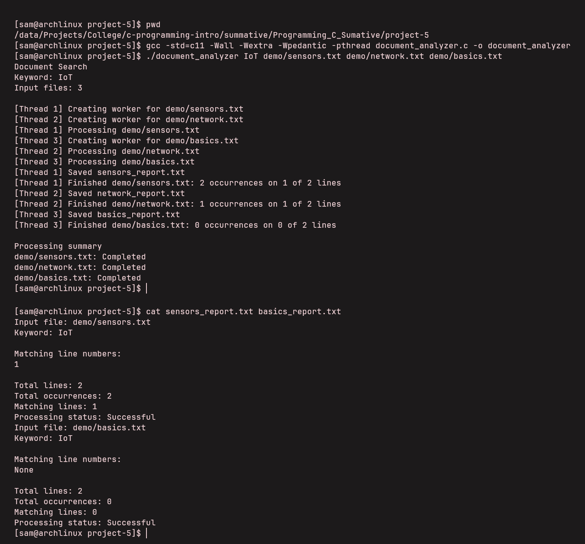
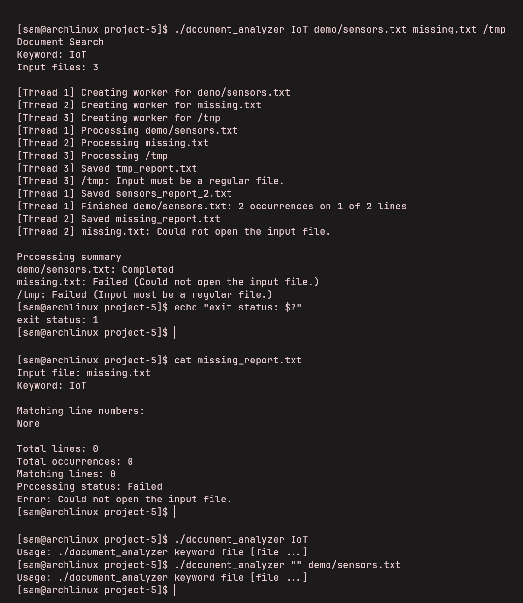

# Multithreaded Document Search

I use this program to search several text files for the same keyword. It saves a report for each file.

## Demonstration

I search three files for the same keyword. The reports are saved in the current folder. If a report already exists, the program adds a number. I copied the three reports into the `demo` folder. From this folder, run:

```bash
gcc -std=c11 -Wall -Wextra -Wpedantic -pthread document_analyzer.c -o document_analyzer
./document_analyzer IoT demo/sensors.txt demo/network.txt demo/basics.txt
cat sensors_report.txt basics_report.txt
```

The order of the worker messages can vary between runs.

### Search results and reports

Each file gets its own thread and report. One file has no matches.



### Error handling

I use a missing file, a folder, and wrong arguments. One bad input does not stop the other worker.



### Supporting files

- Sensors with two hits on one line ([input](demo/sensors.txt), [report](demo/sensors_report.txt))
- Network with one lowercase hit ([input](demo/network.txt), [report](demo/network_report.txt))
- C basics with zero hits ([input](demo/basics.txt), [report](demo/basics_report.txt))

## Build and run

From this folder:

```sh
gcc -std=c11 -Wall -Wextra -Wpedantic -pthread document_analyzer.c -o document_analyzer
```

Run `./document_analyzer` with the keyword first and the paths of the text files after it. Put quotes around a keyword or a path that contains spaces. The reports are saved in the current directory. If a name already exists, the program adds a number.

## How it works

- I give each file its own thread. Each thread reads its file and writes its report. The main thread starts the workers, waits for them with `pthread_join`, and prints the results in input order.
- I read one line at a time. I count matches anywhere in the line and ignore letter case for the English alphabet. After a match, I continue after the matched text. A line with several hits appears once in the list of matching line numbers.
- A file with zero matches still gets a successful report. If an input is missing or cannot be read, the worker writes a failed report when it can. The program returns a nonzero exit status if any file fails.
